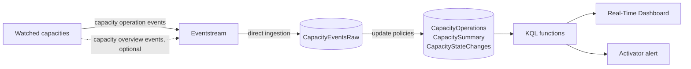

# Fabric Capacity Watch

Minute-by-minute monitoring for Microsoft Fabric capacities, built from Fabric's own capacity
events. It shows utilization, carry-forward and the three throttling measures the way Fabric
computes them, keeps as much history as you want, and alerts you only when Fabric actually delays
or rejects work.

The repo is written to be handed to [Claude Code](https://claude.com/claude-code): it checks your
access first, asks a few setup questions, and walks you through each step. Every step also works by
hand.

## Why

The Capacity Metrics app is the official view, but it keeps 14 days, it is hard to query, and it is
hard to alert on. "We hit 100%" usually turns out to be a short spike Fabric smoothed away, while
real trouble (sustained background load that leads to rejected reports) is easy to miss until users
complain.

Fabric streams every capacity operation as an event in Real-Time hub. Capacity Watch lands those
events in an Eventhouse, rebuilds Fabric's numbers from them, and puts a dashboard and an alert on
top. After setup you can also ask Claude Code questions about your capacity ("why were reports
failing last night?") and it answers from the same functions.

## What you get

- **A Real-Time Dashboard**: a status line per capacity in plain words, utilization (actual and
  already booked), the throttling measures, carry-forward, overage episodes, usage by workspace,
  what changed since yesterday, and rejected operations.
- **One alert** by email or Teams when a capacity starts being delayed or rejected, and again when it
  recovers. Short spikes do not alert.
- **KQL functions** you can query or build on, such as `CapacityStatus()`,
  `CapacityTimeline(24h)` and `CapacityOverageEpisodes(7d)`. See [docs/functions.md](docs/functions.md).
- **30 days of history** by default, as long as you like.



## What you need

- **Capacity admin** on each capacity you want to watch.
- **Contributor** on a workspace that runs on a Fabric (F) or Trial capacity, with room for about
  2 to 3 CU around the clock (see [cost](docs/07-cost-and-limits.md)).
- Python 3.10 or later and the Azure CLI on your computer.

[docs/01-onboarding.md](docs/01-onboarding.md) has the full list and a script that checks it.

## Quick start with Claude Code

```bash
git clone <this repo>
cd fabric-capacity-watch
claude
```

Then ask: **"Set up Capacity Watch for my Fabric capacity."** Claude Code follows
[CLAUDE.md](CLAUDE.md): it checks your access, asks for the decisions, runs the read-only checks and
the KQL deployment (after asking you), and guides you through the parts that only exist in the
Fabric UI, checking each one before moving on.

## Step by step by hand

| Step | Guide | How |
| --- | --- | --- |
| Before you start | [How Fabric measures capacity](docs/00-how-fabric-measures-capacity.md) | Read once |
| 1 | [Onboarding: access and decisions](docs/01-onboarding.md) | `scripts/check_access.py` |
| 2 | [Eventhouse, tables and functions](docs/02-eventhouse.md) | Fabric UI, then `scripts/kql.py deploy` |
| 3 | [Stream the capacity events](docs/03-eventstream.md) | Fabric UI (or REST API) |
| 4 | [Check the numbers](docs/04-validate.md) | Queries |
| 5 | [Dashboard](docs/05-dashboard.md) | Fabric UI, queries in `dashboard/` |
| 6 | [Alerts](docs/06-alerts.md) | Fabric UI |
| | [Cost and limits](docs/07-cost-and-limits.md), [Troubleshooting](docs/08-troubleshooting.md), [Function reference](docs/functions.md) | |

## Cost

About 200,000 CU-seconds a day on the capacity that hosts it (an average of about 2.3 CU), mostly
the Eventhouse's 2 CU minimum. That is about 30% of an F8, 4% of an F64. Each watched capacity also
pays a small amount per event to publish its events. Details and a query to measure your own cost:
[docs/07-cost-and-limits.md](docs/07-cost-and-limits.md).

## How accurate it is

The math follows Microsoft's documented throttling policy: smoothing, carry-forward with burndown,
and the 10-minute, 60-minute and 24-hour measures computed from the usage already booked, with a
reset when a capacity is paused and resumed. The KQL is tested minute by minute against an
independent Python model, and if you also stream capacity overview events,
`CapacityFabricCheck()` compares the rebuilt numbers with Fabric's own on your capacity.

It does not model P SKU autoscale, capacity overage billing, surge protection or Autoscale Billing
for Spark, and it needs one full day of events before background utilization is right. The full
list is in [docs/00-how-fabric-measures-capacity.md](docs/00-how-fabric-measures-capacity.md).

## Repository layout

```text
docs/        step-by-step guides, cost, troubleshooting, function reference
kql/         01-tables.kql (tables, mapping, update policies), 02-functions.kql (everything else)
dashboard/   one query per dashboard tile, with its visual settings
scripts/     check_access.py (read-only access check), kql.py (deploy and query)
tests/       synthetic events, a Python reference model and an end-to-end test
CLAUDE.md    instructions for Claude Code
```

## Tests

The tests run the KQL in Microsoft's local Kusto emulator with synthetic events: an overloaded
capacity that gets scaled up, a short spike that is not a problem, a tight capacity that starts
delaying reports, and a pause and resume. They never touch Fabric.

```bash
docker run -d --name kustainer -e ACCEPT_EULA=Y -m 4G -p 8080:8080 \
    mcr.microsoft.com/azuredataexplorer/kustainer-linux:latest
pip install -r scripts/requirements.txt
python tests/run_tests.py
```

## License

MIT, see [LICENSE](LICENSE). This is a community project, not affiliated with or supported by
Microsoft. Microsoft Fabric is a trademark of Microsoft.
